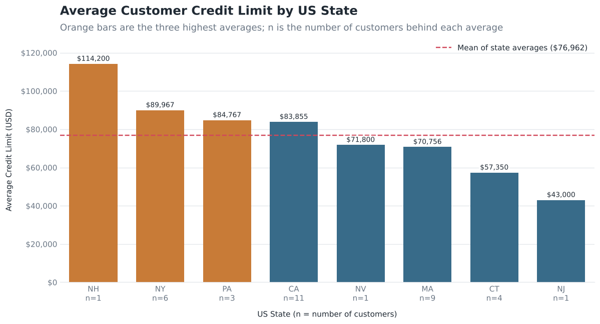
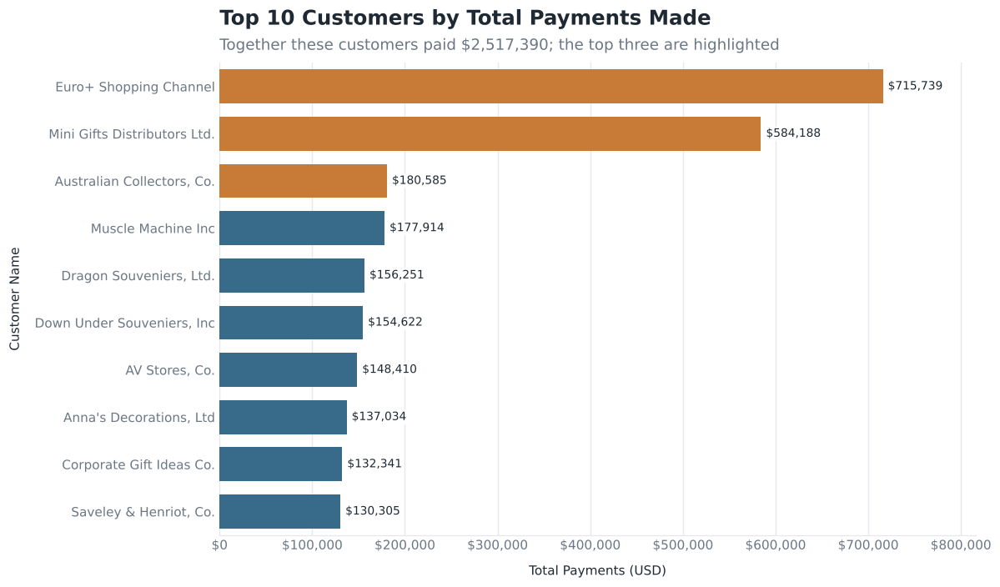
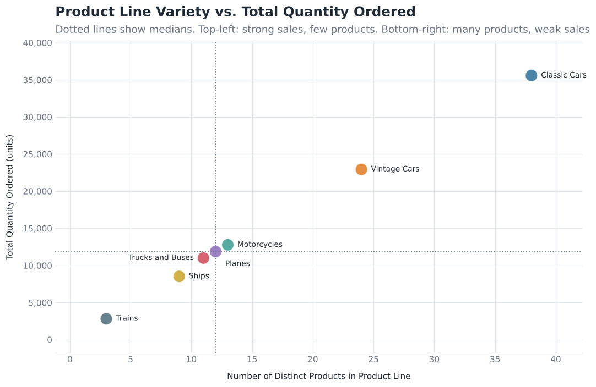
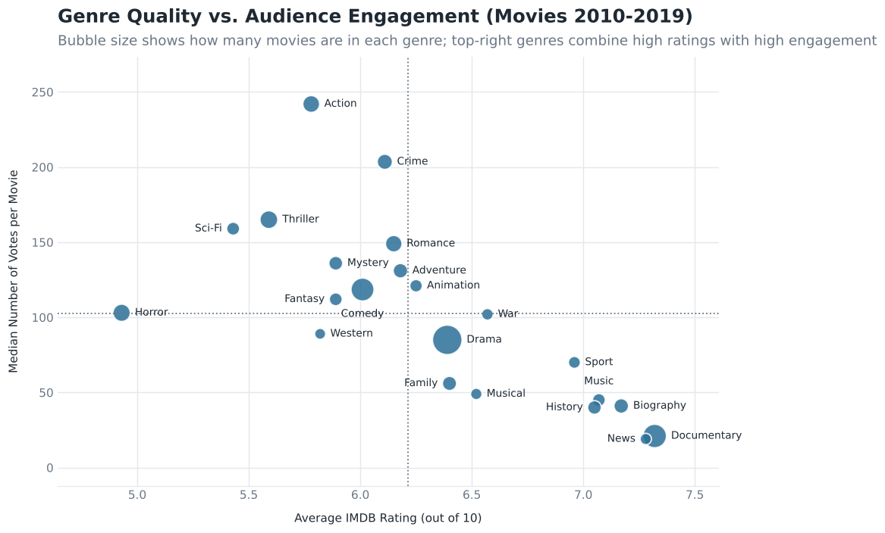

# SQL Summative Lab: Data Extraction and Analysis

> **Project Goal:** To extract, analyze, and visualize data from relational databases using SQL and Python. This project is divided into two parts: querying a customer/product database for a wholesale miniature models company, and conducting an open-ended exploratory analysis on IMDB movie data.

## Table of Contents

* [Project Overview](#project-overview)
* [Part 1: Customer Database Analysis](#part-1-customer-database-analysis)
* [Part 2: IMDB Exploratory Analysis](#part-2-imdb-exploratory-analysis)
* [Technologies Used](#technologies-used)
* [Setup & Installation](#setup--installation)
* [Key Findings & Deliverables](#key-findings--deliverables)
* [Repository Structure](#repository-structure)

## Project Overview

This repository demonstrates proficiency in SQL querying and data manipulation using Pandas. Core competencies displayed include:
* Translating business requirements into complex SQL queries.
* Utilizing `JOIN` operations to retrieve normalized data.
* Applying `GROUP BY` and aggregate functions (`COUNT`, `MAX`, `MIN`, `SUM`).
* Filtering aggregated data using `HAVING` clauses.
* Structuring complex logic using subqueries.
* Visualizing SQL query outputs using Matplotlib, Seaborn, and Pandas.

## Part 1: Customer Database Analysis

**Business Understanding:** The objective is to assist a wholesale distributor of miniature models (cars, motorcycles, planes) by generating reports on customer segments and product performance. This informs future promotional campaigns and inventory management.

**Key Queries Performed:**

| # | Query | What it returned |
| :-- | :--- | :--- |
| 1 | Initial Database Connection | Connects to `data/data.sqlite` with `sqlite3`; every query is read into its own Pandas DataFrame. |
| 2 | Limited Edition California Product Filtering | 10 of California's 11 customers have a credit limit above $25,000 (from $55,400 to $210,500). |
| 3 | International Collectable Campaign Analysis | 15 non-US customers in 12 countries have "Collect" in their name. |
| 4 | USA Credit and Inventory Policy | Average credit limit for the 36 US customers across 8 states, from $43,000 (NJ) to $114,200 (NH). |
| 5 | Top Customers Identification | The 10 biggest payers, with $2.52 million paid in total. |
| 6 | Top Customer and Product Quantities | 2,531 customer-product pairs with 10 or more units purchased, sorted ascending (10 to 308 units). |
| 7 | Product Performance Analysis | 7 product lines, 110 products and 105,516 units ordered, with products and units per line. |
| 8 | Remote Offices Identification via Subqueries | 12 employees in the 5 offices that have fewer than 5 employees, with their supervisors. |

## Part 2: IMDB Exploratory Analysis

**Business Understanding:** The second phase involves open-ended exploratory data analysis on a real-world movie database (IMDB) containing data from 2010 to 2019.

**Objectives:**
* **Initial Exploration:** Identify trends, patterns, and relationships within movie genres, runtimes, personnel, and ratings.
* **Business Question:** Formulate and analyze a specific, data-driven business question.
* **Data Cleaning Assessment:** Identify necessary data cleaning tasks (e.g., handling null values, normalization) prior to deep analysis.

*Note: Null values were excluded from this exploration.*

<!-- ## Technologies Used

* **Database:** SQLite3
* **Data Manipulation:** Python (Pandas, NumPy)
* **Data Visualization:** Matplotlib, Seaborn

**Chart presets:** every chart in the notebook is drawn through a `PRESETS` dictionary and a few helper functions defined near the top of the notebook (`bar_chart`, `hbar_chart`, `labeled_scatter`). Changing the colours, fonts, figure sizes or label formats there restyles all charts at once, and setting `save_charts` to `True` saves each chart as a PNG. -->

## Setup & Installation

To run the notebook locally, install the required libraries (`sqlite3` and `zipfile` ship with Python) and extract the provided database files.

```bash
pip install pandas numpy matplotlib seaborn jupyter
```

```python
import zipfile
import sqlite3
import pandas as pd

# Part 1: customer / product database
conn = sqlite3.connect('data/data.sqlite')

# Part 2: extract the IMDB database
zip_file_path = 'data/im.db.zip'
extract_to_path = 'data/'

with zipfile.ZipFile(zip_file_path, 'r') as zip_ref:
    zip_ref.extractall(extract_to_path)

# Establish connection
conn4 = sqlite3.connect('data/im.db')

# Verify Schema
schema_df = pd.read_sql("""
SELECT * FROM sqlite_master;
""", conn4)
display(schema_df)
```

## Key Findings & Deliverables

> **Note to Reviewer:** *The findings below represent the outcomes of the analysis. A supplementary slide deck (3-5 slides) for Part 2 is also provided alongside this repository.*

### Part 1 Visualizations

**1. USA Credit and Inventory Policy**



*The 36 US customers sit in only 8 states. New Hampshire has the highest average credit limit ($114,200), but it, Nevada and New Jersey each have a single customer, so those averages describe one account. Among states with several customers, New York ($89,967), Pennsylvania ($84,767) and California ($83,855) lead, while Massachusetts ($70,756) and Connecticut ($57,350) fall below the mean of state averages ($76,962) and are the best candidates for a credit-policy review or growth campaigns.*

**2. Top Customers**



*Euro+ Shopping Channel ($715,739) and Mini Gifts Distributors Ltd. ($584,188) paid $1.30 million together, which is 51.6% of the top-10 total of $2.52 million, and each paid 3 to 4 times as much as the third-ranked customer. Ranks 3 to 10 are tightly bunched between $130,305 and $180,585, so the two leaders deserve account-level attention while the rest form a close group.*

**3. Product Analysis**



*Product lines with more products do sell more, and the seven lines sit almost on a straight line (correlation of about 1.00). The reason is that every line sells a similar amount per product, between about 940 and 1,000 units: Classic Cars has 38 products and 35,582 units, while Trains has 3 products and 2,818 units. Classic and Vintage Cars together make up 55.5% of the 105,516 units ordered. With only seven lines and units (not revenue) as the measure, this is a preliminary indication, not proof that adding products would raise orders.*

### Part 2 Exploratory Insights

* **Summary of Initial Exploration:**
  * The database holds 146,144 titles; 145,081 have a start year from 2010 to 2019, and the rest (up to the year 2115) are invalid and excluded. 2019 has only 8,379 titles, about half of 2018, so it looks incomplete.
  * Runtime is missing for 21.7% of titles and genres for 3.7%. After joining ratings and excluding nulls, 65,720 movies remain (about 45% of those in range).
  * The mean rating is 6.32 (median 6.5), but votes are very skewed: the median movie has 62 votes and a quarter have 16 or fewer, so many averages rest on very few votes.
  * Runtime has no linear relationship with rating (correlation -0.007) and contains extreme outliers (3 to 51,420 minutes).
  * Genre quality and engagement pull in opposite directions. Documentary (7.32), News (7.28) and Biography (7.17) are the highest rated but attract few votes (median 21, 19 and 41), while Action (median 242 votes), Crime (203.5) and Thriller (165) attract the most votes but rate lower (5.78, 6.11 and 5.59). Across the 22 genres with at least 100 rated movies the correlation between average rating and median votes is -0.71, and Animation is the only genre above the median on both.

* **Primary Business Question:**
  * Among movies released from 2010 to 2019, which genres pair above-average audience ratings with strong audience engagement, once ratings based on very few votes are removed, and should a new studio prioritise those genres over the most-produced ones (Drama, Documentary, Comedy)?

* **Data Cleaning Tasks Identified:**
  * Remove records with a start year after 2019 (up to 2115) and treat 2019 as a partial year.
  * Exclude nulls in runtime (31,739 titles), genres (5,408 titles) and movies with no rating, rather than imputing them.
  * Split the comma-separated `genres` column into one row per genre (normalization), remembering that genre totals then overlap.
  * Filter or cap runtime outliers (3 to 51,420 minutes) before analysing runtime.
  * Apply a minimum vote threshold (for example 100 votes) before comparing ratings.
  * Check for duplicate movies and inconsistent title text (case, spacing, `primary_title` vs `original_title`), and confirm `movie_id` values match across tables.

**Exploratory Visualization:**



*Each bubble is a genre (size shows how many rated movies it has). Moving right means higher average ratings and moving up means more votes per movie. The genres fall along a downward diagonal: the top-right corner is almost empty, which is what makes the business question worth a deeper look.*

## Repository Structure

```text
├── data/
│   ├── im.db.zip                         # Zipped IMDB database
│   └── data.sqlite                       # Customer/Product database
├── images/
│   ├── toycars.jpg                       # Images used inside the notebook
│   ├── ERD.png
│   ├── movie_data_erd.jpeg
│   ├── step4_avg_credit_by_state.png     # Exported charts for README and presentation
│   ├── step5_top_customers.png
│   ├── step7_variety_vs_orders.png
│   └── part2_genre_quality_vs_engagement.png
├── SQLSummativeLab_completed.ipynb       # Parts 1 and 2: customer database queries and IMDB exploration
├── Presentation_Deck.pdf                 # Slide presentation for Part 2 findings
└── README.md                             # Project documentation

```
